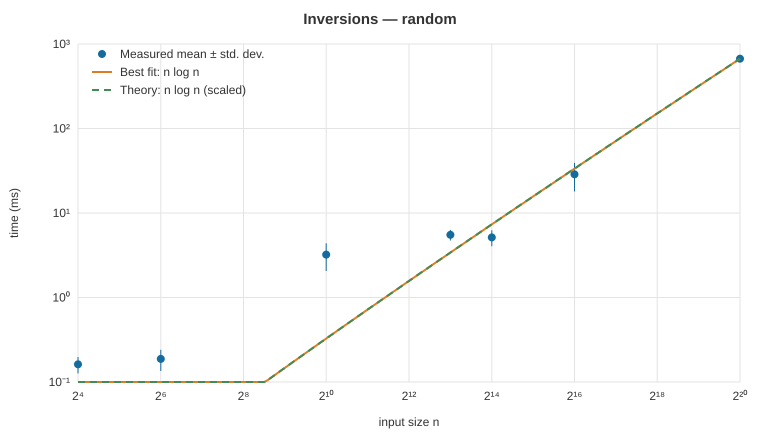
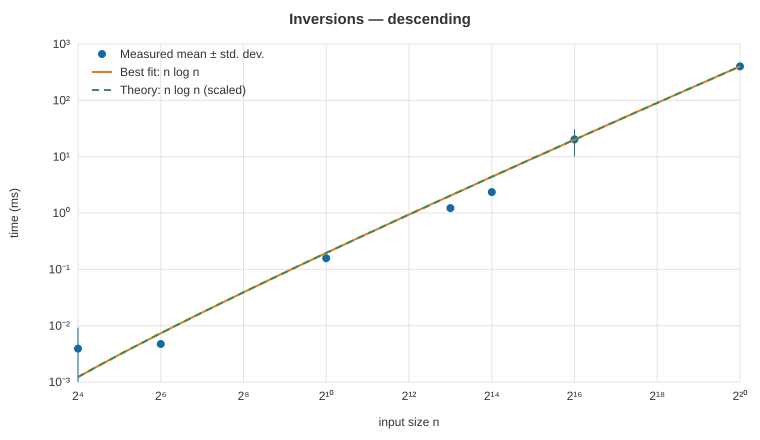
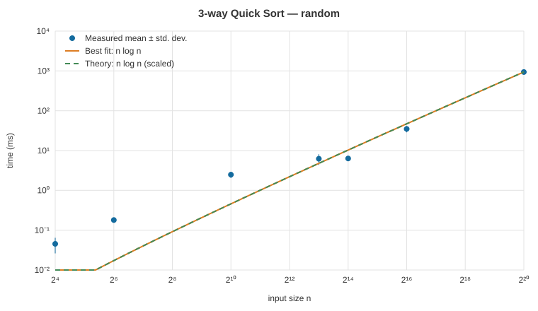
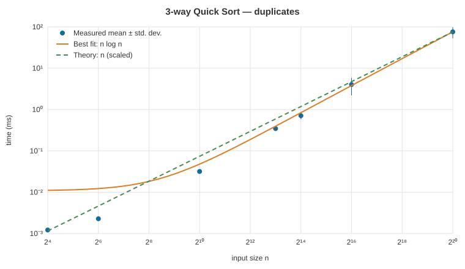
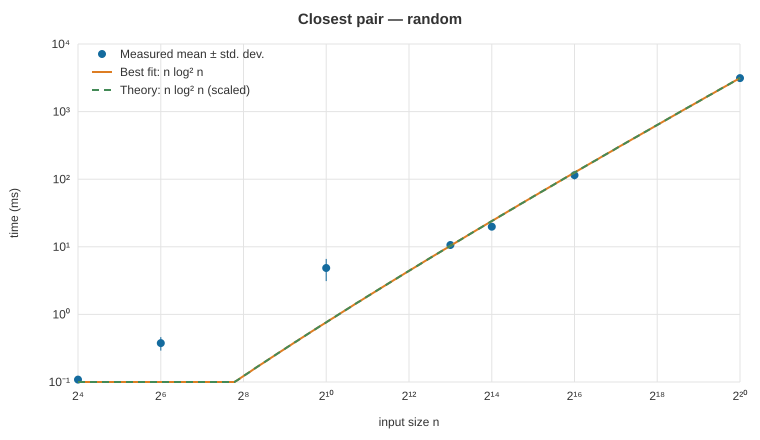
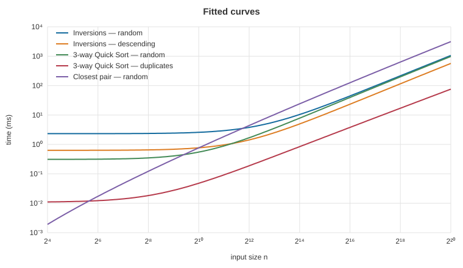

# Experiment report

## Setup

Same machine for every run, JVM with `-Xms256m -Xmx2g`:

```
Recorded UTC: 2026-10-11T22:01:46.915915900Z
OS: Windows 11 10.0 amd64
Java: 17.0.20.1+1
Available logical processors: 16
CPU: AMD Ryzen 7 260 w/ Radeon 780M Graphics (AMD64 Family 25 Model 117 Stepping 2, AuthenticAMD)
Physical RAM (GiB): 31.3
Maximum JVM heap (MiB): 2048
Scala: 2.13.16
Additional warmups: 5 per dataset; recorded runs: 11; discarded: run 0; averaged: runs 1..10
Seed: 20261011; sizes: 16, 64, 1024, 8192, 16384, 65536, 1048576
```

- **Sizes:** 16, 64, 1,024, 8,192, 16,384, 65,536, 1,048,576. Categories follow the assignment: Toy < 10², Small < 10⁴, Medium < 10⁵, Large ≥ 10⁶.
- **Scenarios:** random and descending lists (inversions); random values and only 5 distinct values (Quick Sort); random points in a 10⁹ range (closest pair).
- **Procedure:** inputs come from a fixed seed and are saved to `data/input-*.txt`. Each input gets 5 untimed warm-up runs, then 10 + 1 timed runs; the first timed run is discarded and the other 10 are averaged. Raw times are in `data/raw.csv`.
- **Fitting:** least squares of `a·f(n) + b` (a, b ≥ 0) for f(n) = n, n log n and n². Each plot shows the measurements, the best fit and the theoretical curve scaled to the last point.

## Results

### Inversions — random

| Category | n | Mean (ms) | Std. dev. (ms) |
|---|---:|---:|---:|
| Toy | 16 | 0.162 | 0.035 |
| Toy | 64 | 0.188 | 0.053 |
| Small | 1,024 | 3.218 | 1.160 |
| Small | 8,192 | 5.521 | 0.793 |
| Medium | 16,384 | 5.138 | 1.095 |
| Medium | 65,536 | 28.673 | 10.645 |
| Large | 1,048,576 | 670.152 | 56.006 |



### Inversions — descending

| Category | n | Mean (ms) | Std. dev. (ms) |
|---|---:|---:|---:|
| Toy | 16 | 0.004 | 0.005 |
| Toy | 64 | 0.005 | 0.000 |
| Small | 1,024 | 0.158 | 0.011 |
| Small | 8,192 | 1.223 | 0.178 |
| Medium | 16,384 | 2.347 | 0.184 |
| Medium | 65,536 | 20.259 | 10.133 |
| Large | 1,048,576 | 400.457 | 21.102 |



### 3-way Quick Sort — random

| Category | n | Mean (ms) | Std. dev. (ms) |
|---|---:|---:|---:|
| Toy | 16 | 0.045 | 0.019 |
| Toy | 64 | 0.180 | 0.024 |
| Small | 1,024 | 2.477 | 0.434 |
| Small | 8,192 | 6.218 | 1.882 |
| Medium | 16,384 | 6.330 | 0.395 |
| Medium | 65,536 | 34.915 | 6.259 |
| Large | 1,048,576 | 939.615 | 131.620 |



### 3-way Quick Sort — duplicates

| Category | n | Mean (ms) | Std. dev. (ms) |
|---|---:|---:|---:|
| Toy | 16 | 0.001 | 0.001 |
| Toy | 64 | 0.003 | 0.001 |
| Small | 1,024 | 0.045 | 0.010 |
| Small | 8,192 | 0.494 | 0.309 |
| Medium | 16,384 | 0.821 | 0.321 |
| Medium | 65,536 | 4.470 | 1.049 |
| Large | 1,048,576 | 73.047 | 23.018 |



### Closest pair — random

| Category | n | Mean (ms) | Std. dev. (ms) |
|---|---:|---:|---:|
| Toy | 16 | 0.118 | 0.015 |
| Toy | 64 | 0.347 | 0.091 |
| Small | 1,024 | 1.820 | 0.889 |
| Small | 8,192 | 6.388 | 0.912 |
| Medium | 16,384 | 12.875 | 1.488 |
| Medium | 65,536 | 69.449 | 9.226 |
| Large | 1,048,576 | 2094.428 | 150.675 |



### Comparison



"Growth" is how much the time multiplies from n = 65,536 to n = 1,048,576.

| Scenario | Theory | Best fit | R² n | R² n log n | R² n² | Measured growth | Theoretical growth |
|---|---|---|---:|---:|---:|---:|---:|
| Inversions — random | n log n | n log n | 0.9994 | 0.9999 | 0.9987 | ×23.4 | ×20.0 |
| Inversions — descending | n log n | n log n | 0.9997 | 1.0000 | 0.9980 | ×19.8 | ×20.0 |
| 3-way Quick Sort — random | n log n | n log n | 0.9991 | 0.9998 | 0.9991 | ×26.9 | ×20.0 |
| 3-way Quick Sort — duplicates | n | n | 1.0000 | 0.9999 | 0.9970 | ×16.3 | ×16.0 |
| Closest pair — random | n log n | n log n | 0.9989 | 0.9996 | 0.9992 | ×30.2 | ×20.0 |

## Analysis

- **Pattern:** time grows steadily with n in every scenario; nothing grows exponentially.
- **Best fit vs. theory:** the best-fitting model matches the theoretical complexity in every scenario: n log n, except Quick Sort with 5 distinct values, which is linear (O(n·k) with fixed k).
- **Why every R² is high:** the largest size dominates the least-squares error, so any increasing curve near that point scores well. The growth columns and the log-log plots are better evidence.
- **Does theory predict the time?** It predicts the shape of the growth, not the milliseconds. At n ≈ 10⁶ random inputs grow somewhat faster than predicted, because immutable lists use hundreds of MB and the garbage collector works harder.
- **3-way partition:** with 5 distinct values Quick Sort is over 10× faster than on random values at the largest size.
- **Unusual sizes:** Toy times are microseconds, so clock noise dominates. Some scenarios barely change between 8,192 and 16,384 because of JIT optimisation between series.

## Sources of error

- Garbage collection pauses, which grow with memory use.
- JIT compilation may not be finished after 5 warm-up runs.
- Background processes of the operating system.
- One input per size (fixed seed).
- Quick Sort timing includes a linear pass over the output to consume the result.
